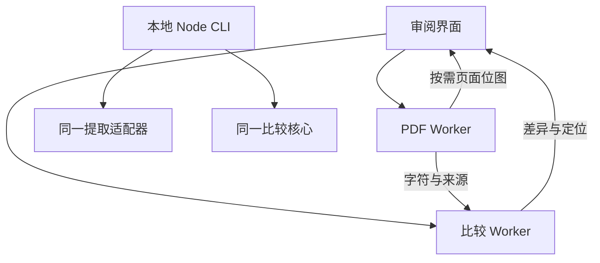

# 保单 PDF 比对工具完整执行方案

版本：v2 + A/B-1（增量覆盖见 CODEX_ENGINE_AB_AMENDMENT.zh-CN.md），替代 2026 年 10 月 23 日实施方案中的冲突决定。  
日期：2026 年 10 月 26 日。  
执行对象：本地 Codex 或云端 Claude Code。  
产品范围：用于保险文档审阅的浏览器应用与本地命令行工具。

本项目交付一个可以实际审阅两份 PDF 的工具。用户看到新增、删除、修改和移动，能够回到两侧原文，并知道哪些内容没有比较完成。首要目标是避免重要变化被丢失或隐藏；浏览器性能与完整本地调试是交付要求。

本文件规定要实现的行为与验收。随包的规则验证集已经生成并检查，产品代码、产品评分器和浏览器性能仍由执行代理实现和验证。不要把方案中的目标写成已经完成的结果。

## 1 已确定的决定

| 项目 | 执行决定 |
| --- | --- |
| 主执行环境 | 优先本地 Codex；同一套方案也适用于云端 Claude Code，云端完成后补目标电脑验收。 |
| 首版应用 | React 与 TypeScript Web 应用。开发用 localhost，生产可以静态托管或交付 Linux 容器。 |
| PDF 计算位置 | 默认在浏览器。Node CLI 用于本地复现、回归和自动化。首版不建设远端 PDF 上传比对服务。 |
| 提取和渲染 | 公共接口后保留 PDF.js 与 MuPDF.js 两个实现；共用核心/UI，独立依赖和构建；每次任务两侧固定同一个引擎。 |
| 比对核心 | 新项目默认 TypeScript 纯逻辑核心。只在性能分析证明必要时，将明确热点替换为 Rust/WASM；不同时维护两套正式核心。已有经验证的 Rust 实现应先评估复用，不能仅为符合默认语言而重写。 |
| 数据契约 | 保留可追溯原文、标量区间、映射和覆盖；MuPDF 原生字符 origin/quad 保留，PDF.js 提取项通过一致文字层范围定位并声明精度。 |
| 敏感度 | 所有成功提取的文字、数字、标点和符号进入比较。角色与分类不能删除内容。 |
| 默认显示 | 所有内容变化默认可见。普通续期、标签、连字变化也可见；首版不做业务规则自动折叠。 |
| 匹配顺序 | 可靠主体和字段身份优先；自由条款可靠原样对应先于局部替换。结构路径不能禁止有证据的跨章节移动。 |
| 表格 | 声明支持的表型、列和行键；首批 Aircraft Schedule。不能默认把首列或显示行号当身份。 |
| 不完整结果 | 明确区分 partial、failed、cancelled；不能用“无差异”代替未完成。 |
| 交付方式 | 一条功能分支、按里程碑提交。能创建远程 PR 时按既有授权建立一个 draft PR；不自动合并或发布生产。 |

本次不开发 OCR、LLM 条款解释、通用表格识别、跨文档库搜索、桌面安装器、专门的 PDF/Excel 报告排版或多租户任务平台。已有明确需求不因本列表被删除；执行者先核对仓库与用户新指令，再记录必要差异。

## 2 成功标准和支持范围

### 2.1 用户可完成的工作

1. 选择左侧基准版和右侧待审版，可手动交换。续保可显示为到期保单与续保保单。
2. 看到提取和比较进度，可以取消。
3. 浏览差异列表，看到旧文、新文、所属主体/字段或条款以及分类理由。
4. 点击差异定位两侧原文；移动提供旧位置与新位置。
5. 搜索当前两份文档中的词或短语。
6. 看见未覆盖页面、图片区域、对应歧义和计算未完成的范围。
7. 下载包含版本、范围、差异与覆盖状态的 JSON 结果；本地 CLI 能产生同一契约结果。

日期识别可以提醒上传方向可能相反，但不得自动交换；同一期间的修订版也必须可比较。界面统一使用“基准 → 待审”的方向。

### 2.2 支持边界

| 输入内容 | 首版行为 |
| --- | --- |
| 首批英文文本型保单 | 比较可提取的文字、金额、日期、符号和原文标签。 |
| 同一字段骨架的模板漂移 | 支持标签别名、标题编号、页眉、分页、有限拆段合段和章节顺序变化。 |
| 其他 Unicode 文字 | 保留并进行通用文本比较，不承诺已经验证同等领域结构识别。 |
| 声明过的航空器明细表 | 行增删、重排、键变化、数值变化、重复表头、已验证的跨页续接。 |
| 扫描页与嵌入图片条款 | 原样显示，提示没有完成文字比较；无 OCR 时不承诺读取图片中的金额。 |
| DRAFT、CANCELLED、旋转状态、可提取勾选符号 | 进入文字比较，默认可见。 |
| 图片印章、矢量勾选框、电子签名有效性 | 不作业务内容识别；检测到相关未支持对象或疑似文字区域时提示限制。 |
| 交互表单和批注 | 不承诺独立字段值或批注对象完整比较；有对象时明确提示当前范围。 |
| 密码保护 PDF | 允许用户本地提供密码；无法打开则明确失败。密码不进入日志或结果。 |
| 损坏或超限文件 | 清楚拒绝或返回未完成原因，不能产生正常的零差异结论。 |

“完整”只指声明的可提取文本范围。不能根据抽到页码或页眉，就声称整页正文已经覆盖。

### 2.3 完成分为两层

**工程验证版完成**：本地可运行、32 对规则用例及补充机制测试通过、评分器反例通过、浏览器流程实际验证、必需性能预算通过、Linux 容器构建与启动验证通过。必需项存在 FAIL/BLOCKED/NOT_RUN 时，可以移交当前开发快照，但不能称工程验收通过。

**业务试点可发布**：在工程完成基础上，真实样本与留出验收通过、许可及实际平台要求已落实、目标设备性能通过。真实样本尚未提供时，可交付工程版本，业务试点状态保持未完成。

## 3 执行环境与接手方式

### 3.1 推荐本地 Codex

本项目需要反复检查本机 PDF、实际浏览器高亮、滚动、取消与内存。Codex CLI 能在授权目录读取和修改仓库、运行本机工具。[S1] 云端 Claude Code 也能实现算法、运行测试和构建 Linux 容器，但它使用独立云端环境，本机工具与未同步文件不会自动出现。[S2][S3]

这个选择依据是执行环境，不是模型能力排名。如果使用本地 Claude Code，同样具有本地调试的便利。无需同时维护两条开发分支或让两个代理重复开发。

如果选择云端：先把本方案和虚构验证包真正放入它能访问的仓库或会话材料。ChatGPT 的 sandbox 路径或私人文件链接不是其他代理可直接读取的磁盘路径。交付后将同一提交拉回目标电脑，执行浏览器和性能验收。云端 localhost 不能被当作用户已可访问的线上预览。

### 3.2 开发代理的数据边界

本地运行代理不等于本地模型推理。被读入提示、工具输出或截图的内容可能发送给模型服务；最终产品在浏览器本地处理，与开发代理读取真实保单是两个不同的数据流。[S4][S5]

默认以本包虚构 PDF 开发。真实文件按明确授权使用；未获准进入代理上下文时，不让代理全文读取或把全文打印到日志。不能用“只上传 DocInput”替代数据授权，因为 DocInput 可能包含全文。

### 3.3 接手步骤

执行者先读取当前目录说明、AGENTS.md、CLAUDE.md、已有源码和测试，检查 git 状态及运行工具。保留用户未提交改动；必要时用独立 worktree。没有仓库时，在用户指定目录创建最小项目，不主动创建外部仓库。

生成一页 `docs/implementation-status.md`：实际仓库基线、已有实现、计划差异、T0 证据、当前里程碑和阻塞。已有事实可以决定实现细节，无需重复询问用户。不能把默认技术栈当作重建现有成熟项目的理由。

## 4 架构和目录

### 4.1 新项目默认技术栈

React、TypeScript、Vite；Node 使用执行时仍受支持且满足依赖要求的 LTS 版本，记录精确版本；新项目使用 pnpm 并固定 packageManager 和锁文件。核心测试采用 Vitest，浏览器端到端测试采用 Playwright。已有仓库使用等效工具时优先复用。

PDF.js 和 MuPDF.js 是两条独立构建的 PDF 读取/显示依赖；Python 3.10+、ReportLab、pypdf、Pillow 仅用于随包测试数据生成和构造检查，不进入产品运行依赖。不要引入第二条 PyMuPDF 产品提取链路。

所有依赖在实现时核对实际包与 API 后锁版本。本文引用的 latest 文档不能代替安装版本的源码和导出签名检查。

### 4.2 浏览器运行结构



B 路线的 PDF Worker 持有 MuPDF 文档，逐页提取并处理按需渲染；比较 Worker 运行纯核心。这样核心比较不会阻塞新页面渲染。提取任务按页让出执行机会，渲染请求有优先级；单页同步调用无法及时取消时，主线程以终止 Worker 兜底。

初版不为每一页创建 Worker。若后续为了翻页另开渲染 Worker，重复 WASM 实例、PDF 缓冲和文档内存必须计入预算。

字符数据按页交给比较 Worker。界面只保留展示所需的差异与当前定位信息，不常驻复制整份 DocInput。公开契约可以导出 JSON；运行时可采用紧凑数组与 transferable buffer，禁止以“零拷贝”为名忽略进入 WASM 或文档引擎时的真实复制。

A 路线允许主线程薄调度层配合 PDF.js 内部 Worker 与 DOM 文字层；比较核心仍在独立 Worker。两条路线都必须验证取消、迟到消息隔离和完整资源口径。

### 4.3 目录职责

| 建议路径 | 职责 |
| --- | --- |
| `apps/web/` | 文件选择、双栏 PDF、差异清单、搜索、Worker 调度。 |
| `packages/contracts/` | 数据 schema、运行时校验和由 schema 推导的 TS 类型。 |
| `packages/pdf-adapter/` | 公共适配接口；engines/pdfjs 与 engines/mupdf 分别实现提取、覆盖和定位。 |
| `packages/compare-core/` | 结构化、对应、差异、分类、搜索；不访问文件、DOM、网络或时钟。 |
| `packages/cli/` | Node 本地读取文件并调用同一适配器、核心和输出格式。 |
| `profiles/` | 首批模板、字段别名、表格列/键、日期格式，带版本。 |
| `tests/fixtures/` | 受控虚构 PDF 及其评估资料；产品包不得导入答案文件。 |
| `tests/evaluation/` | 产品结果适配与独立评分器。 |
| `tests/browser/` | 高亮、交互、网络和任务生命周期测试。 |
| `bench/` | 长文档工作负载、浏览器基准与报告工具。 |
| `deploy/` | 静态服务容器、配置、健康检查、OpenShift 示例。 |
| `docs/` | 许可范围记录、实现状态、运行说明、验收报告和限制。 |

核心 API 概念为 `compare(docLeft, docRight, profile, budget)`。配置和确定性工作量预算显式传入；进度、取消和超时由外层控制。输入校验与规范化结果序列化只有一个实现来源。

## 5 数据契约

### 5.1 共同约定

内部页码从 0 开始，界面从 1 开始。公开文本区间统一为 Unicode 标量索引的半开区间 `[start, end)`，并写明对应 raw 或 match 文本。JS 字符串的 UTF-16 下标不能直接充当标量下标；使用统一偏移表转换。

`rawText` 指提取器提供、尚未经过业务规范化的文本，不是 PDF 文件内部原字节，也不承诺能绕过字体编码缺陷恢复绝对视觉原文。

版本至少覆盖 schema、提取器、提取选项、核心、分词和 profile。时间、耗时、机器名不进入规范比较结果；放入运行报告。

### 5.2 DocInput 必需信息

| 对象 | 必需信息 |
| --- | --- |
| 文档 | schemaVersion、内容哈希、提取器版本/选项、页数、坐标规范、诊断。 |
| 页面 | pageIndex、显示页面宽高、变换及逆变换、字符、行提示、图像/异常区域和覆盖信息。 |
| 字符/提取项来源 | 稳定来源 ID、原始提取字符/标量范围、字号、样式引用、来源或推断标记、定位方法与几何精度；MuPDF 保留原生 origin/quad，PDF.js 保留提取项及文字层 scalar/UTF-16 区间。 |
| 行提示 | 字符来源列表、方向、横排/竖排、基线参考及其测量/推断来源。 |
| 逻辑单元 | 组成它的原字符来源，角色，章节/主体/字段候选及可靠程度。 |
| 未覆盖区域 | 文档侧、页码、区域、原因、证据和可供界面显示的说明。 |

来源 ID 从稳定的文档、页、遍历序号生成，不用时间或随机数。一个字形可能对应多个 Unicode 标量，允许它们共享几何，并标记共享关系。不能平均切分字形矩形，冒充精确字符位置。

### 5.3 坐标和基线

统一页面坐标为处理裁剪和页面旋转后的显示页左上角原点，x 向右，y 向下，单位 pt。适配器保存从提取器坐标到规范坐标的变换；MuPDF 已经处理的旋转不能再处理一次。[S6]

quad 在契约中定义为文字局部方向的左上、右上、左下、右下四点，即 `[ul.x,ul.y,ur.x,ur.y,ll.x,ll.y,lr.x,lr.y]`；绘制多边形时使用 `ul,ur,lr,ll`。旋转后不重新按屏幕 x/y 猜四角身份。

几何规范快照按 0.001 pt 量化，使用明确的对称舍入规则 `sign(x) * floor(abs(x) * 1000 + 0.5)`，归零负零，拒绝非有限值；适配器调试记录可保留原浮点值。量化用于稳定表示，不保证独立提取永远相同。

基线是排版参考线，不能用 bbox 底边替代。基线和方向帮助组行；MuPDF 词级高亮取原字符 quad，PDF.js 使用来源一致的真实文字层区间测量。跨行、跨页高亮必须分片，不能涂成一个覆盖整段的大矩形。仅有提取项区域时标明 run 精度，不能当作已经完成精细定位；两版定位标准相同。

### 5.4 两种文本和来源映射

每个逻辑单元保留：保真文本、用于找对应的 matchText、以及 matchText 到原字符来源的映射和变换记录。

匹配可以使用明确的连字展开、空白规整、字段标签别名，以及经过测试的 Unicode 规范化。实际差异只从保真文本生成。NFKC 后相同不代表原文没有差异。

来源映射必须支持一对多、多对一和删除/插入记录：`fi → fi` 的两个匹配字符回到同一原字形；组合字符合成一个字符时，来源覆盖参与合成的原字符。不能逐字符调用 NFKC 后拼接就假定等于整串 NFKC。

优先对当前需要的有限变换实现明确映射。需要完整 NFKC 时，使用可验证映射的实现，或以稳定字符簇为块并校验拼接结果与整体规范化一致；不一致时扩大来源块并标记映射精度，不能返回错误的精确位置。规范化用于候选匹配，不替代最终 raw 差异的位置计算。

组段推断的空格、换行和分页分隔符标为逻辑分隔，不伪造 PDF 字符。仅几何换行变化可以不产生内容变化；原文中的连字符、标点与真实空白变化须按可解释规则保留。

### 5.5 CompareResult 契约摘要

以下是需要实现的字段语义，执行者在 contracts 中给所有引用类型正式定义和校验。

```typescript
type ResultStatus = "complete_for_scope" | "partial" | "failed" | "cancelled";
type DifferenceKind = "Added" | "Removed" | "Replaced" | "Moved";
type Category = "Material" | "Review" | "RollForward" | "Cosmetic";

interface CompareResult {
  schemaVersion: string;
  coreVersion: string;
  extractors: [ExtractorIdentity, ExtractorIdentity];
  documentHashes: [string, string];
  extractionSnapshotHashes: [string, string];
  configDigest: string;
  scope: "extracted_text";
  status: ResultStatus;
  differences: Difference[];
  coverage: CoverageIssue[];
  unresolved: UnresolvedRegion[];
  alignment: ScrollAnchor[];
  stats: CompareStats;
}

interface Difference {
  id: string;
  kind: DifferenceKind;
  category: Category;
  structurePath: StructurePath | null;
  left: SourceLocation[];
  right: SourceLocation[];
  oldText: string;
  newText: string;
  textOps: TextOperation[];
  hasTextChange: boolean;
  defaultVisible: true;
  matchEvidence: MatchEvidence;
  reviewReasons: string[];
  occurrences: Occurrence[];
}
```

`SourceLocation` 必须能解析到文档侧、页码、单元/原字符区间、quad 列表及精度，不能只有外部无法解析的 ID。`TextOperation` 带旧新来源和新增/删除/相同操作。`StructurePath` 包含章节、主体、字段或表格行身份及可靠程度。`MatchEvidence` 说明身份、唯一原样、邻居、相似度等证据，得分不是概率。

`Moved` 可带 `hasTextChange=true` 和内部 textOps。`alignment` 只保存滚动用单调锚点；完整移动关系留在差异来源中。重复页眉分组用 occurrences 保留每处证据。

`CoverageIssue` 表示未提取、未识别或提取失败的范围；`UnresolvedRegion` 表示对应/计算未完成的范围。运行状态、覆盖缺口和身份待复核分别记录，UI 再形成整体提示。

核心接收到冻结 DocInput、配置和预算后，应产生稳定的规范结果。排序、平局、序列化和 ID 生成固定；不能用 localeCompare 的环境差异或运行速度决定完整结果。

## 6 提取适配器和覆盖检查

### 6.1 接入前先证明四件事

本轮本地评估已授权，检查安装版本的代码与导出签名，以真实 PDF 跑通：原文来源、可解析位置、连字保留、页面渲染坐标一致。MuPDF 验证逐字符遍历和原生几何，PDF.js 验证提取项、Unicode 标量/UTF-16 映射和同来源文字层范围。把版本、选项和结果记录到 `docs/extractor-capabilities.md`。

MuPDF 使用 StructuredText 的逐字符 walk；不要用只保留行文本的简化 asJSON 代替字符契约。官方 API 区分两种输出，walk 提供行方向和逐字符 origin、quad 等信息。[S7] PDF.js 显式验证 disableNormalization: true，提取和文字层沿用一致选项与来源核对，不把这一选项当作完全无损保证。

MuPDF 首轮候选提取配置固定保留连字、原有空白和图像区域；关闭 preserve-spans 与自动 dehyphenate。为了不混淆原始字符与推断空格，优先使用 inhibit-spaces 后由适配器显式生成逻辑分隔；两个引擎如采用推断空格，均必须确认其来源标记可靠。实际选项以锁定版本验证结果为准。[S8]

明确记录 ActualText 的处理方式、可见裁剪规则和未知编码策略。不能把未知 glyph/CID 当成正常字符继续宣称完整。单个必需能力缺失，应记录能力缺口并修复/替换该路径；不能靠降低标准答案掩盖。

### 6.2 逐页覆盖检查

逐页检查原生文字、图片区域、正文区域文字分布、未知编码、解析异常。至少区分：有可比较文本、已确认空白、疑似正文缺失、失败。

整页扫描以及文字页里的图片条款必须列出具体页/区域；仅提取到页码不构成覆盖证明。普通 logo 不能一律当正文，但也不能只因图片小或靠角落就认定无业务含义。无法判断的图片区域保留未核验提示；明确装饰区域的排除必须属于版本化模板配置。

保留成功提取内容继续比较。已知缺口令整体 partial。不能对所有文件一律 partial 来躲避覆盖验收：普通完整文本样本要求 complete_for_scope。

### 6.3 资源管理

文档在任务期间由 PDF Worker 持有；页面、结构化文本、位图按生命周期显式 destroy，try/finally 覆盖异常路径。[S9] 位图按需生成并限制缓存；取消、关闭、开始新任务时终止旧任务，清理对象和 URL。

任务消息带 taskId 与 generation。旧任务迟到的结果不得覆盖新任务。终止 Worker 后旧文档句柄无效，新任务重新打开，不复用失效对象。

## 7 结构化和对应算法

### 7.1 先组织内容而不删内容

保留引擎行提示，再根据方向、基线、栏位和局部间距修复必要问题。阈值按字号/行高归一化；旋转文本按自身方向处理，不对全页统一按 y/x 排序。

每个原字符必须被一个主逻辑单元覆盖，或列入未归类区域；表格表头等可有多个展示引用，但不能因重复引用重复计算。建立字符守恒检查，发现归类时丢字就失败。

识别标签栏与内容栏。`SUM` 这类短标签不能自由配给整段长条款。页眉、页脚、标题、印章候选只提供角色与分组信息，不排除比较。

页眉重复率分别在每份文档中计算。数字掩码只用于找重复区域，不改变进入最终差异的原文。单页文档不能凭重复率判定页眉。

### 7.2 先绑定可靠主体与字段

字段路径至少包含章节、主体、字段，例如 `risk_details / original_insured / address` 与 `risk_details / reinsured / address`。同名 ADDRESS 不等于同一字段实例。

声明别名 `SUMS INSURED` 与 `SUM INSURED` 可以帮助对应，但原标签变化仍保留。文档编号、前导零、年份和标题编号不能全局抹掉。

可靠身份相同时，值完全变化仍按替换比较，不受模糊相似度门槛限制。R10 两个主体的地址互换必须报两项字段修改，不能把同一字符串跨主体配成移动。

身份识别不确定时，保留候选与原文，不把一个低可信推断变成后续不可突破的硬约束。

### 7.3 表格先建立逻辑行身份

每种支持表格配置表名/表头别名、列身份、主键、次级键、金额/币种/单位列以及续行规则。显示序号和首列不默认是键。

Aircraft Schedule 优先使用已验证的注册号或序列号组合；主键改变而唯一次级键相同，可以继续对应并报告主键变化。主次键冲突时不得按行顺序强配。

跨页先恢复逻辑表，再比较行和单元格。重复表头不算新增业务行；表头措辞实际变化仍可见。行重排不制造虚假价值变化。缺键、重键、未支持合并单元格等进入待复核。

R25 重复键组的金额变化必须可见并链接两侧金额原文，实体归属可以不确定。单独报重键警告不能满足该用例。

### 7.4 对未绑定条款保护可靠原样对应

在自由条款中建立保真内容指纹。只有内容一致、唯一性与上下文支持的候选才优先保留。几何推断的换行/分页分隔不参与内容指纹；真实大小写、标点、数字和符号仍参与。

先保留旧条款 A 在新位置的可靠对应，再让原位置的相似新条款 B 参与剩余匹配，防止局部替换吃掉移动证据。

重复原文不能只取第一处。结合主体、邻居、数量与局部顺序消歧；仍不确定时保留组级差异和待复核。相同条款在不同主体下出现时，可靠主体身份优先。

章节是强证据而不是绝对墙。条款跨章节移动有证据时仍建立全局链接，显示语境变化。

### 7.5 局部对应和有限拆合

从可靠对应取单调子集形成窗口，在窗口内共同选择 1:1、1:2、2:1、增、删。1:2/2:1 只能使用相邻段落，不能跨明确字段、主体或表格边界任意拼接。动态规划共同考虑这些操作，避免先锁死所有 1:1 后再补拆合。

跨页续接结合缩进、方向、字段和句法；新章节、新主体、新标签和表格边界是强阻断信号。不能仅凭下一页小写开头就删除前页连字符。

候选冲突按证据等级解决：可靠业务身份、可靠唯一原样对应、上下文支持的近似对应。证据接近时保留待复核，不为减少差异数量强配。

### 7.6 分词、相似度和计算预算

分词规则带版本，排除空白 token，保留单词、数字、小数、币种、百分号和标点的区别。通用 Unicode 回退固定规则，不能让浏览器默认 locale 决定核心结果。

令词 token 数为 n、m，公共子序列长度为 L，候选得分为 `2L/(n+m)`。十个普通词改一个是 0.90，三十个改一个约 0.967。空白不进入该分母。两侧没有有效词时不作正文模糊锚点，但纯符号仍通过身份或保真差异保留。

新项目初始模糊替换候选门槛 0.60；模糊跨区候选可用 0.95 与至少 8 个有效词作为更保守的初值。它们只筛候选，不决定有没有变化，也不能把高相似度直接定义为移动。短字段、确定身份和原样移动不套用这组门槛。所有初值写入 profile，在开发集校准后冻结。

安全长度上界是 `2*min(n,m)/(n+m)`。只有该上界低于候选门槛才可安全跳过；可再用 token 多重集合交集形成更紧上界。不得用未经证明的词重叠阈值删掉必需候选。

初始预算：最多 20,000 个模糊候选对、累计 token 长度乘积不超过 100,000,000。预算是工作量限制，不是耗时结论；版本化并在性能阶段校准。确定身份的字段走直接比较，不被候选预算过滤；其词级差异也需独立工作量上限。

预算用尽的区域进入 unresolved 并整体 partial。可以保留已经确定的字段变化和两侧全文证据；未完成词级定位时明确粒度不足。不能删掉剩余单元、只报已完成部分然后宣称完整。

### 7.7 最后从保真文本产生差异

对每个对应单元执行保真 token/字符差异。金额、小数、标点、否定词和符号必要时细化到字符。规范化相同的单元仍需比较 rawText，确保标签、连字和标点变化没有提前消失。

已经完成对应搜索仍无对象的内容生成新增或删除；因预算或歧义未完成的内容标记为未决，不伪装成已经确定的增删关系。所有变化都有原文来源。

移动由相对内容顺序或结构位置变化判断。只因换页、字体增大或 y 坐标改变，不算条款移动。移动与内部文字修改可以同时存在。

### 7.8 同步滚动独立计算

完整对应允许交叉。同步滚动只取可靠对应中的加权单调子集，稳定处理平局，并在相邻锚点间插值。没有可靠锚点时暂停联动或保守页级跟随。

点击移动差异可以跳转两侧旧新位置，但普通滚动不沿交叉链接反复跳动。

## 8 分类和高敏感展示

差异先产生，再分类。分类不能成为删除器。

| 类别 | 含义 | 默认行为 |
| --- | --- | --- |
| Material | 明确字段的金额、币种、比例、期限长度，或已识别责任措辞等变化 | 排前、可见。 |
| Review | 对应或含义不确定、跨章节移动、未知符号等 | 可见，解释不确定点。 |
| RollForward | 明确识别的续期变化 | 可见，不自动折叠。 |
| Cosmetic | 标签、连字、空白或编号等形式变化 | 有真实字符变化仍可见；不制造虚假的业务内容变更。 |

这里的分类辅助审阅，不输出法律责任已经扩大/缩小的确定结论。

日期格式由 profile 指定。普通续期标识至少要求同字段、日期无歧义、连续性正确、期限按自然月/年或既定天数口径不变。同段还有金额或其他变化时分别展示；不能整个单元归为续期。15 个月变 12 个月必须显示期限变化，闰年不能简单按 365/366 天判断自然年变化。

金额保留原字符串、币种和十进制值，避免二进制浮点丢精度。`$` 未有上下文时不自动当 USD。编号前导零、and/or、否定词、逗号、±、勾选状态不全局忽略。

重复页眉的同一变化可以合并一张卡，保留全部 occurrences。只按结构和实际旧新变化相同才分组；不同金额不能被合并成一个事件。显示组数、出现次数、用户筛选隐藏数分别统计。

用户可以主动折叠或筛选；默认视图不得预先隐藏内容变化。自动业务折叠规则不在本版开发范围。

## 9 浏览器审阅体验

双栏页头始终显示文件身份和基准/待审方向。差异卡片给旧文、新文、自然语言理由及原文入口。新增只有右侧、删除只有左侧；表格显示可确定的行身份、列名和旧新值，身份不确定时直说。

MuPDF 高亮使用原字符 quad；PDF.js 使用一致文字层的范围测量，同页同方向可合并短片段。连字共享几何时高亮共同字形；不能为了“词级高亮”均分段落框。搜索复用来源映射，支持子串和短语、左右或两侧范围；不引入 BM25 或向量库。

视图按可见页和有限邻页渲染。固定任务状态区显示进度、取消、未覆盖页数和待复核项。支持连续比较不同文档，不必刷新页面清内存。

JSON 导出保留 scope、status、coverage、unresolved、版本及输入哈希。诊断包可能含全文，只在用户明确导出时创建；文件名、全文和差异不进入默认远端日志。若浏览器本地模式有登录或静态资源请求，网络测试需区分允许的应用资源与文档内容传输。

## 10 状态和失败语义

| 场景 | 必须产生的行为 |
| --- | --- |
| 支持范围比较完成，有或无变化 | complete_for_scope；无变化时写“可提取文本中未发现差异”。 |
| 扫描页、图片正文或页解析失败 | partial，列出侧、页/区域和原因，保留已比较结果。 |
| 对应预算用尽 | partial，保留完成部分和未处理范围。 |
| 表格身份不明但文字变化已发现 | 可见 Review 和两侧证据；首版保守设 partial，禁止虚构唯一行身份。 |
| 损坏文档或无法打开 | failed，指出文件与原因，不进入正常零差异结论。 |
| 用户取消 | cancelled；立即反馈，停止后台工作，旧结果不能回流覆盖新任务。 |
| 超过文件/页数/字符上限 | 明确限制，不只截前若干页继续宣称完整。 |
| Worker 崩溃、OOM、硬超时 | failed 或带明确未完成范围的 partial；不能成功返回空数组。 |

任务状态和测试状态不同。测试报告用 PASS、FAIL、BLOCKED、NOT_RUN。支持的有效输入崩溃是 FAIL；缺少运行环境是 BLOCKED；尚未执行是 NOT_RUN。不能把产品缺陷包装成环境阻塞。

## 11 浏览器性能预算

### 11.1 固定测量口径

参考设备优先为普通 16 GiB 办公电脑、至少 4 个逻辑 CPU、受支持的桌面 Chrome/Edge。P0 记录实际 CPU、内存、操作系统、浏览器版本和电源模式。高配开发机结果另列，不能替代参考设备。

计时从用户启动比较，到完整差异列表可用且首个原文定位可操作。应用/WASM 首次下载与初始化另记冷启动；热运行只允许应用资源已加载，每轮仍重新读取、提取和比较 PDF，不复用缓存的 DocInput 或 CompareResult。

每类工作负载至少运行 20 次热比较，报告中位数、p95、最大值，另记冷启动。保留提取、传递、结构化、匹配、差异和首屏渲染分项；不能只报核心函数时间。

### 11.2 初始开发预算

以下是开发目标，不是本方案已经取得的性能成绩。若达不到，先报告瓶颈并优化，不擅自放宽数值或减少比较内容。

| 项目 | 初始目标 |
| --- | --- |
| 小型工作负载 | 每份不超过 10 页、3 万提取标量；热比较 p95 不超过 3 秒。 |
| 标准工作负载 | 每份不超过 50 页、20 MiB、15 万提取标量；热比较 p95 不超过 20 秒。 |
| 首批容量上限 | 每份 100 页、30 MiB、50 万提取标量；测试上限样本的完成/降级行为，不能用小样本速度代表它。 |
| 交互响应 | 比较期间筛选、滚动操作有响应；自动交互测试响应 p95 目标 100 ms，明显长任务需定位。 |
| 取消 | 界面立即反馈；目标 1 秒内停止计算，必要时硬终止对应 Worker。 |
| 内存 | 标准工作负载相关进程/Worker/WASM/位图的可归因峰值目标 1 GiB 内；不得只测 JS heap。 |
| 重复任务 | 连续 20 次比较与取消不出现未释放任务、持续无界内存增长或标签页崩溃。 |
| 运行时网络 | 浏览器本地模式无 PDF、DocInput、全文、文件名或差异内容上传。 |

小型与标准性能工作负载必须属于声明支持范围，20 次运行均完成所有应完成的提取、对应和差异计算，并通过已知变化断言。预算耗尽得到 partial，以及 failed/cancelled，均计为该轮失败，不能算速度达标。报告保留全部尝试及失败数，不得只对成功样本计算分位数而隐藏失败。容量上限样本另按运行前定义的完成或显式降级合同验收。

内存工具不提供完整口径时，在报告中明确未覆盖部分，完整内存验收为 NOT_RUN/BLOCKED。浏览器内存池可能保留已释放容量，不能只凭一次 RSS 不回落认定泄漏；结合对象存活、WASM 分配与多轮趋势判断。

### 11.3 性能工作负载

现有 32 对 PDF 主要为每份 2–3 页，属于功能集。新增三类独立性能样本：正常续保长文档、密集跨页表格、模板大改且大量相似段落。每类覆盖小型、标准和容量上限，并保留已知变化断言。

不要只重复同一页或使用自比对测性能，那会掩盖候选比较成本。新增长样本属于性能工作负载，不能冒充独立真实留出集。

### 11.4 何时允许引入 Rust

先处理明显的全组合比较、重复复制、全页预渲染和对象未释放。仍未达标，且分析显示比较核心占主要可优化耗时，才对一个热点做受限原型。

迁移条件是同样本端到端明显改善、内存不超预算、来源/确定性/全部功能验收保持通过；将新模块替换旧模块，不能长期保留两套正式算法。未达到可见收益就停止迁移，继续 TS。Rust 不应成为 P0 前置工程。

## 12 规则验证集和评分器

### 12.1 已提供的材料

随包 `validation/` 对应规则集 seed 20261026：32 对、64 份 PDF、130 页。每对含 before/after PDF、source.json、expected.json、layout.json；附生成器、构造检查器、固定依赖和字体许可。构造检查已通过；这不是产品通过率。

共有 29 个预期事件：26 个普通必须发现事件、R25 一个允许身份待复核但金额必须可见的事件、R27/R28 两个覆盖提示事件。六对控制用例不能制造业务变化。所有需要发现的文字变化均 may_fold=false。

产品只接收 PDF 和通用 profile。答案文件、case ID、文件哈希到答案的映射不得成为产品输入或分支。哈希可用于缓存身份和测试清单，不能用于硬编码行为。

### 12.2 按事件而非卡片评分

产品评分器将结果映射到预期事件，分别记录发现、对应、位置、可见性、完整性和虚假变化。不能要求产品输出生成器专属 run ID；通过文字、页/区域、主体上下文与自身可解析来源核对。

按 detection_requirement 三路执行：

| 分支 | 验收 |
| --- | --- |
| must_detect | 正确旧新值、主体/字段、允许操作/类别、原文证据、默认可见。 |
| visible_text_delta_with_identity_review | R25 的 2,250,000 → 2,375,000 必须可见并有双侧证据；身份可以 unresolved。 |
| coverage_warning_required | 相应页/图片区域的可见缺口和 partial；不能计作识别图片内金额。 |

不能把 must_detect=false 一律跳过。R25 的 must_detect_text_delta 和双侧来源要求仍是硬条件。

评分步骤：按旧新内容提出候选；核对原文位置与主体；核对操作/类别；核对默认可见；核对来源与高亮；最后核对全局状态与禁止事项。一个预期事件只记一次成功，可以由多个差异片段共同支持；一张卡含多个事件时各自独立取证。

同字段修改仅显示删除加新增，可记“发现通过、对应失败”；是否全项通过按该用例允许操作决定。不能用总分抵消关键失败。

位置检查以正确词、页面、方向和合理区域为主。layout.json 是逻辑字符格，不是字形墨迹边界，不与提取器 quad 做字节相等断言。整个页面或整个字段涂色不能冒充一个词的精确定位；上下文标签可以用于身份判断，不要求全部上下文都高亮。

### 12.3 六个控制用例必须单独验收

R01 没有内容差异；R15 拆段不产生虚假增删；R16 重分页不变成业务移动；R17 字体字号不制造文字变化；R23 行重排不改变实体价值；R24 跨页和重复表头不造成行遗漏或新增。

不得把虚假变化全部分类为 Review 后宣称“没有 Material，所以通过”。检查实际操作和文本不变量。

### 12.4 评分器必须能拒绝假结果

给评分器注入以下错误输出，全部应失败：在有必须发现或覆盖要求的用例中返回空结果；整份 PDF 一条泛化警告；金额正确但主体/页码错；事件正确但默认隐藏；扫描缺口却 status 完整；R25 只有重键提醒；无效来源引用；左右方向反转。R01 等控制用例允许符合其合同的空差异列表，不应因此失败。

这些是评估程序的测试，防止产品与评分器共同犯错。

### 12.5 最少补充机制测试

新增小型 DocInput 或专用 PDF 用例，不必扩成庞大资料库：重复原文只改其中一份；跨章节移动同时改一词；非 BMP/组合字符/连字映射；旋转页与非零 CropBox、UserUnit；预算耗尽；单页提取失败；取消与旧消息回流；连续任务释放与浏览器网络边界。

坐标和提取能力必须用 PDF 端到端验证，不能全部用人工 DocInput 代替。核心反例可以用小型冻结 DocInput 快速回归。

### 12.6 真实样本和留出

从 P1 尽早引入至少 3 对获准真实 PDF；P2–P4 累计 3–5 对完整人工审阅，另留至少 3 对来自不同模板或生成来源的未调参样本。用户能提供更广材料时，再扩大关键断言集，不把固定 20 对当开工门槛。

真实样本由审阅人看可读清单与原文，不要求业务人员手工编辑机器 JSON。留出预期先由人工确认并封存；见过失败后该样本转为回归，新选留出样本。换 seed 不构成独立真实留出。

没有授权样本时继续合成开发，真实样本验收保持 BLOCKED。不得拿不相关公开 PDF 代替用户业务样本并宣称业务已经通过。

## 13 服务器和部署

### 13.1 首版必须交付的部署方式

本地开发服务与生产静态构建均可运行。生产容器默认 Linux，CPU 架构与部署节点一致，非 root 运行、监听非特权端口（例如 8080），提供健康检查、静态资源 MIME、Worker/WASM 路径和前端路由回退。

PDF 内容在浏览器计算，服务器只交付应用资源与组织需要的认证入口。静态服务不接收保单上传；本地使用不依赖 SSO。生产 SSO 接入依赖实际组织配置，不能用一个假登录按钮冒充完成。

依赖/WASM 自托管并锁版本，不在运行时从随意 CDN 获取。默认不持久化文档内容；关闭任务释放资源，不宣称能够证明浏览器内存被安全擦除。

已有 OpenShift 时申请项目/命名空间、CPU/内存/临时存储配额、镜像仓库、域名/TLS、登录与发布权限，无需为本工具新建集群。镜像适应平台分配的任意非 root UID，不假设 /root、应用目录或用户主目录可写。[S10]

### 13.2 Harness 与 OpenShift

Harness 负责把指定软件版本按流程发布；OpenShift 负责运行容器与管理入口、资源、重启和扩容。[S11] 构建可以由现有 CI 完成，Harness 只承担发布部分。

交付容器、部署配置、健康检查和回滚说明；有实际平台授权时再做目标环境部署验证。没有账号或网络时，平台验证标记 BLOCKED，不能声称已部署。每天开发不要求先运行 Harness 或本机 OpenShift。

OpenShift/Harness 目标环境属于可选组织接入验证，不纳入默认 `pnpm verify` 的必需集合；没有该平台权限不阻塞工程验证版交付。工程版仍必须实际完成本地 Linux 容器构建与启动验证。业务试点采用该平台时，再把对应接入作为该试点的发布条件。

### 13.3 可选的远端计算扩展

只有明确需要集中计算、共享留存或本地资源不足时启用。届时复用选定引擎的 Node 适配器与公共核心，不引入第三个 PDF 引擎。浏览器不自动把超限文件上传，用户须明确知道并使用获准路径。

初始后端压测可给一个 worker 2 vCPU、4 GiB、同时一对文档；这是待测预算，不是生产最低配置或集群规格。当前文字比较先用 CPU，不配置 GPU。

远端服务需用户/任务/结果权限检查，解析子进程或容器隔离，文件/页数/CPU/内存/临时空间/时长上限，有限并发和真正取消，任务文件清理，日志避免全文。长任务采用提交、进度、结果和取消接口；是否需要独立队列服务由实测决定。

本节是扩展约束，不在本次默认执行范围内实现 HTTP 上传服务。

## 14 命令和自动化验收约定

下列命令是执行代理需要交付的接口，不表示当前包已包含产品代码。已有仓库可提供等价命令，但 README 必须给出准确映射。

| 命令 | 交付行为 |
| --- | --- |
| `pnpm env:check` | 检查实际 Node/包管理器/浏览器/测试资料/许可状态，输出缺项，不打印凭据。 |
| `pnpm dev` | 启动本地 Web 开发服务，说明地址。 |
| `pnpm build` 与 `pnpm preview` | 构建并本地运行生产产物，Worker/WASM 路径正确。 |
| `pnpm verify:core` | 不依赖 MuPDF 的 schema、来源映射、核心与评分器反例。 |
| `pnpm test:pdf` | 用真实合成 PDF 检查提取、坐标与覆盖。 |
| `pnpm test:rules` | 执行全部 32 对产品评分并生成可读/JSON 报告。 |
| `pnpm test:browser` | 双栏、高亮、移动、搜索、取消、重复任务和网络边界。 |
| `pnpm bench:browser` | 跑固定工作负载，输出环境、分项、p95、内存口径与正确性。 |
| `pnpm compare -- --left a.pdf --right b.pdf --out result.json` | 同一适配器和核心的 Node CLI。 |
| `pnpm verify` | 汇总必需验收；FAIL/BLOCKED/NOT_RUN 都不能显示全部通过。 |

CLI 正常比较完成返回 0，无论有无差异；partial 返回 2；失败/无效输入返回 3；取消返回 130。测试汇总使用自己的结果状态和非零退出码，避免把发现差异误当测试失败。

CI 默认运行核心、合成 PDF、规则评分与生产构建；浏览器测试在可用环境执行。真实受限 PDF 不提交公开仓库，CI 使用已获准的保管方式。参考设备性能验收与云端 CI 分开记录。

## 15 许可与实际阻塞事项

### 15.1 本地双引擎评估已授权（A/B-1 覆盖旧 T0）

用户已明确授权 PDF.js 与 MuPDF.js 的开发及本地技术比较。核对锁定包的 LICENSE/COPYING 与真实存在的限制，不因未购买商业许可暂停本地开发，不重复索取授权。分别记录本地评估、对外分发、共享部署、生产发布和商业授权状态；未证实的范围不宣称批准。PDF.js 为 Apache-2.0 路线，MuPDF 为实际适用的 AGPL 或有效商业许可路线；不称“无许可证/必须付费”。

### 15.2 其他边界按时点处理

| 时点 | 必要事实 |
| --- | --- |
| 使用真实 PDF 前 | 来源与使用权限、是否可进入代理上下文、存储位置和访问人。 |
| 引入远端处理前 | PDF/DocInput/日志是否可发往该环境，保留与清理规则。 |
| 接入公司环境时 | 仓库、包源、镜像仓库、登录、网络与资源配额。 |
| 试点前 | 支持范围、真实验收、目标设备性能、许可材料、清理和回滚。 |

是否需要正式审批以实际组织制度为准，不额外创造通用审批流程。缺一个条件只阻塞依赖它的路径；继续完成已经允许且可独立验证的部分。

## 16 里程碑和任务拆分

不要求执行代理每完成一阶段都询问是否继续。按依赖持续推进，完成一个可审阅阶段就提交并更新状态。没有可依据的工期数据，不承诺 AI 几小时完成整套产品。

| 阶段 | 任务 | 交付和退出条件 |
| --- | --- | --- |
| P0 接手与准备 | E00 环境/仓库/现有许可；E01 工作区与版本；E02 数据契约；E03 验证集和评分器骨架 | 保留已有改动；32 对资料完整；schema 与核心测试入口可运行；阻塞明确。 |
| P1 最小完整链路 | E04 公共提取接口和两版定位；E05 双 Worker 和取消；E06 最小核心/CLI；E07 双栏与定位 | R01、R02、R18、R27 从 PDF 输入到产品结果、独立评分和浏览器定位通过；首份端到端性能分项。 |
| P2 结构和对应 | E08 主体字段/标签/跨页；E09 原样对应、局部拆合、移动；E10 表格键和歧义 | R10/R13/R15/R16/R22–R26 等通过；没有字符丢失或强配吞变更；至少 3 对真实样本有条件时已进入。 |
| P3 完整审阅 | E11 保真差异与分类；E12 分组/搜索/滚动/导出；E13 覆盖和异常 | 32 对按各自合同通过；评分器错误输出全部被拒绝；覆盖、可见性、方向和高亮完整。 |
| P4 性能和运行 | E14 三类长样本与浏览器剖析；E15 有证据优化；E16 Linux 容器与部署说明 | 参考设备预算与重复任务通过；本地与生产构建一致；Linux 验证实际执行。未达标时可移交快照但本阶段不通过。 |
| P5 真实验收和交付 | E17 完整审阅/封存留出；E18 许可材料、用户说明、验收与版本冻结 | 工程和业务完成状态分别给出；当前范围无关键未解决漏报/错误完整结论；交付可复现结果。 |

P1 是最早的方向检查点：如果字符来源、几何或覆盖不成立，先修这些基础问题，不继续堆分类与搜索。E03 的评分器必须在最小链路阶段实际评估输出，不能等产品做完再补“验收脚本”。

真实样本准备与许可可并行推进，但不让开发者凭空编出业务签收。P4 的性能不能等所有功能完成才首次测量，P1 起持续保留基线。

## 17 每阶段报告与最终交付

每阶段记录提交号、输入/验证包哈希、提取器和核心版本、profile、环境、实际命令、PASS/FAIL/BLOCKED/NOT_RUN、失败证据和下一步。普通实现细节不要求用户逐个决定。

最终至少交付：

1. Web 应用、CLI、两个独立适配器与一个公共核心、契约和 profile。
2. 本地安装启动、生产构建、Linux 容器与回滚说明。
3. 32 对产品评分报告、评分器自身反例结果、补充机制测试和浏览器证据。
4. 三类性能工作负载与实际浏览器报告，说明冷/热、设备、峰值内存口径。
5. 真实样本审阅和留出状态；缺失时如实写未完成。
6. 许可范围记录、第三方清单、与实际版本一致的交付材料。
7. 支持范围、已知限制、未解决风险，以及一条功能分支上的清晰提交历史。

如已有远程仓库和授权，可推送功能分支并创建一个 draft PR，正文解释问题、行为改变、验收和未完成项。没有远程权限时交付本地提交及 PR 正文。不得强推、覆盖用户改动、自动合并主干或自行生产发布。

## 18 停止扩展和遇到冲突时的规则

达到上述范围和验收后停止新增功能，交用户试用。不要为假想的任意 PDF 格式继续泛化，不为“可能更快”提前引入 Rust，不为部署方便建设新平台。

发现输出与标准答案冲突：保存失败证据，判断产品错误、样本错误或范围冲突。产品错误修产品；样本错误需给源数据/变换矛盾证据并独立修正，不能自动用当前输出重生成 expected。不得删除失败用例、降低关键可见性要求，或把本来支持的输入改标“不支持”来获得全绿。

遇到许可、真实数据、凭据、网络或目标设备缺口，完成不受影响部分，将相应项写 BLOCKED，给出最小必要的缺失信息。外层资源限制是停止计算的依据，不能成为漏报或伪造完整结果的依据。

## 19 相对于上一版的最终调整

| 上一版决定 | 本版执行方式 |
| --- | --- |
| Rust 核心为默认 | 新项目默认 TS，只有实测热点值得迁移时才使用 Rust；已有 Rust 不无故重写。 |
| 已批准规则可以默认折叠 | 本版所有内容变化默认可见，自动业务折叠暂不做。 |
| 合成反例主要为设计清单 | 已有真实生成的 32 对 PDF；新增独立产品评分器和评分器反例。 |
| 主要强调浏览器本地模式 | 明确本地调试、PDF 计算位置、生产托管三个维度；Linux 静态容器是交付项，远端计算服务是可选扩展。 |
| Worker 为一般要求 | 明确提取/渲染与核心计算调度，取消硬停止和迟到消息隔离。 |
| 全文原样优先容易被误读 | 可靠主体/字段身份先绑定，自由条款原样对应优先；跨章节仍允许有证据移动。 |
| 固定样本数量与人力排期 | 按代理里程碑推进，真实样本有最小要求但不阻塞独立工程工作，不伪造业务通过。 |

字符来源、两种文本、表格身份、覆盖不足、单调滚动锚点和实际许可边界继续保留；提取器按 A/B-1 改为两个独立实现。

## 20 技术依据

来源用于核对依赖能力与环境；具体实现仍须阅读锁定版本的代码、类型声明和运行结果。算法与预算属于本项目设计，不是官方文档给出的性能保证。

- S1 [Codex CLI](https://developers.openai.com/codex/cli/)
- S2 [Claude Code 云端会话](https://code.claude.com/docs/en/claude-code-on-the-web)
- S3 [Claude Code 云端环境](https://code.claude.com/docs/en/cloud-environments)
- S4 [Codex 本地执行的数据流说明](https://learn.chatgpt.com/docs/hipaa-configuration)；仅引用输入发送到模型服务这一技术事实，不将该页的行业要求引入本项目。
- S5 [Claude Code 数据使用](https://code.claude.com/docs/en/data-usage)
- S6 [MuPDF 坐标系](https://mupdf.readthedocs.io/en/latest/reference/common/coordinate-system.html)
- S7 [MuPDF StructuredText API](https://mupdf.readthedocs.io/en/latest/reference/javascript/types/StructuredText.html)
- S8 [MuPDF 结构化文本选项](https://mupdf.readthedocs.io/en/latest/reference/common/stext-options.html)
- S9 [MuPDF.js 官方项目与资源管理示例](https://github.com/ArtifexSoftware/mupdf.js)
- S10 [OpenShift 镜像运行要求](https://docs.redhat.com/en/documentation/openshift_container_platform/4.20/html/images/creating-images)
- S11 [Harness CD 概述](https://developer.harness.io/continuous-delivery/new-to-continuous-delivery/overview)
- S12 [Artifex 许可方案](https://artifex.com/licensing)


## A/B-1 有效增量要求

原第 1/4/6 节的唯一引擎限制由两个适配器替代，公共核心/UI/profile/评分器继续共用。字符 quad 对 MuPDF 保留；PDF.js 允许提取项原文、Unicode 标量/UTF-16 区间和实际文字层范围测量，禁止均分文本段伪造字符坐标。结果分开记录 coreVersion 与提取器身份。缓存及任务按引擎/版本/选项隔离，无静默回退。

第 11/14/16/17/19 节按增补文件执行：dist/pdfjs 与 dist/mupdf 独立构建，PDF.js 路线可在未安装/下载 MuPDF 的环境下构建运行；双方独立完整 32 对验收。正式 A/B 使用同提交、同 PDF 字节、同核心/profile/预算/尺度，平衡 A/B、B/A 次序，每引擎每工作负载至少 20 热运行和至少 3 冷启动。完整性/定位失败不能计速度通过。增加 docs/engine-comparison.md，分别报告公共、两引擎、A/B、工程和业务状态。原性能预算及验证集不降低。
