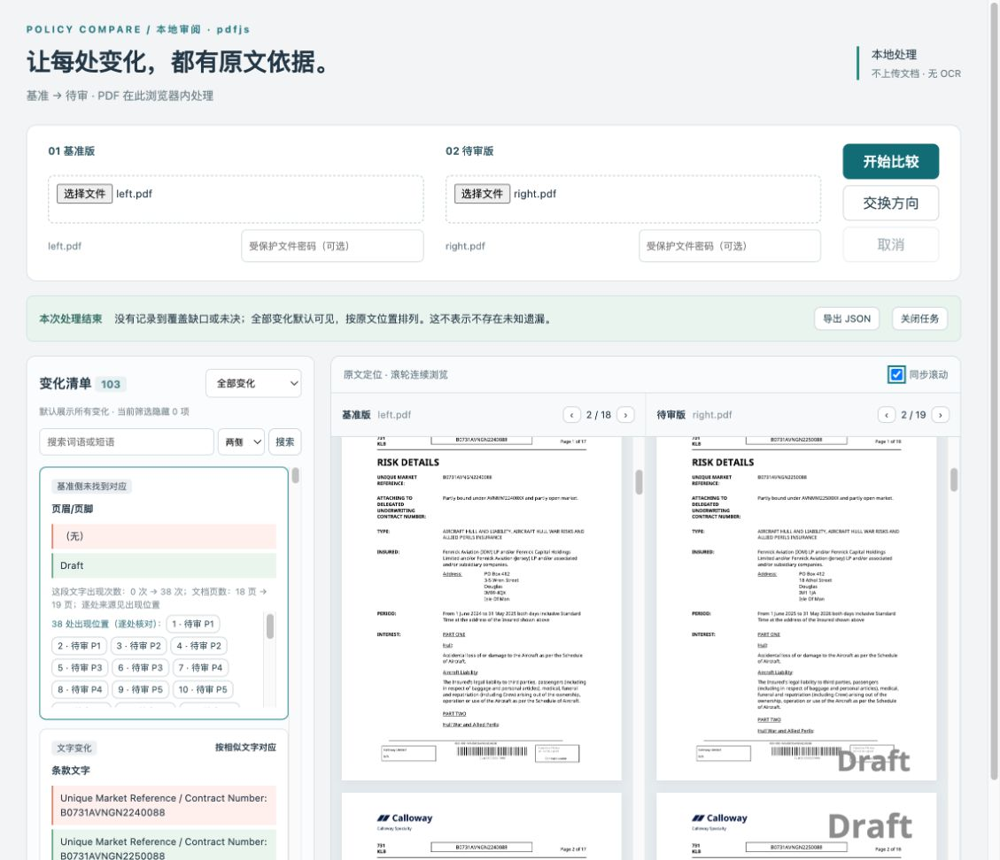

# 原文区域连续滚动

原界面每侧只挂载一页 PDF，滚轮到页底后没有下一页可以继续浏览。本次把原文区域改成连续页面：鼠标放在任一 PDF 画面内，滚轮或触摸板向下可跨入下一页，向上可返回上一页；也可拖动区域内的滚动条。页码随滚动更新，原来的上一页／下一页按钮保留。

关闭“同步滚动”后两侧独立浏览。开启时沿用比较结果已有的文字位置对应，允许跨页跟随；没有对应线索时不强行跳到相同物理页码。卡片、搜索、覆盖缺口和逐处来源的跳转改为连续文档中的实际位置，高亮仍由原有引擎文字层解析。

## 实现范围

- 每页保留按 PDF 宽高比例计算的占位区域，保证完整的连续滚动距离。每侧仅缓存当前页及相邻页，最多3页图像／文字层；每侧最多1个渲染请求在途，快速滚动后优先处理最新目标，离开窗口的旧图像 URL 和文字层会释放。
- 使用当前连续文档中的页面偏移计算来源定位和同步滚动。浏览区域宽度变化后保留当前页及页内阅读位置。
- 修正“末页比浏览区域矮时，滚到底仍显示倒数第二页”的问题。
- 本轮没有修改提取器、比较核心、独立评价器或导出格式；没有新增页面身份推断。缓存上限和任务资源检查不能代替完整内存峰值或指定设备性能验收。

## 本地验证

Node 24.22.1、pnpm 10.12.1；两引擎构建通过。

| 浏览器检查 | PDF.js | MuPDF |
|---|---|---|
| 新增连续滚动：上下跨页、两页交界同屏、首尾边界、独立浏览、同步跨页、按钮、窗口宽度变化、短页末尾及快速往返 | 3/3 | 3/3 |
| 既有重复次数展示、减少次数、真实页眉修改 | 3/3 | 3/3 |
| 既有审阅：相同文件、金额、搜索、导出、连字／扫描、覆盖定位、取消、20次任务替换及交换方向 | 6/6 | 6/6 |
| 合计 | **12/12** | **12/12** |

复用已有 R16、R09 等作者固定 PDF，没有修改文件或预期。现有审阅测试只将“单张图片就绪”检查改为“当前活动页就绪”，与相邻页预加载兼容。可重跑命令：

```sh
pnpm build:pdfjs
pnpm build:mupdf
POLICY_ENGINE=pdfjs pnpm exec playwright test tests/browser/scroll.spec.ts tests/browser/repeat-display.spec.ts tests/browser/review.spec.ts --reporter=line
POLICY_ENGINE=mupdf pnpm exec playwright test tests/browser/scroll.spec.ts tests/browser/repeat-display.spec.ts tests/browser/review.spec.ts --reporter=line
```

保存的最终输出：[PDF.js 构建](build-pdfjs.log)、[MuPDF 构建](build-mupdf.log)、[PDF.js 浏览器测试](tests-pdfjs.log)、[MuPDF 浏览器测试](tests-mupdf.log)。没有把这24项定向测试表述为核心、浏览器全套、容器或业务验收全部通过。

## 用户原文件的实际页面核对

在 PDF.js 页面重新选取用户的 `left.pdf`、`right.pdf`，仍为18／19页、103张变化卡。实际通过浏览器滚动接口操作：

截图文件来源已额外核实：GitHub API 当前确认 `jiehuan/falcon-mini` 为公开仓库；本机两份 PDF 的 Git blob 分别为 `136363eadd3059a3159d006d764b60ae6f07ed8b`、`7d525c9e3a49c7e387d725ee97578ff8f1147561`，与公开 `testdata/renewal/bizav_2024_vs_2025` 中同名文件逐字节一致。[公开来源及本机哈希核对](public-source-check.json)保存 API 地址、文件大小、Git blob 和 SHA-256；截图内容来自这两份已公开测试文件。

- 关闭同步，待审侧向下滚一屏进入第2页，基准侧仍停在第1页。
- 待审侧滚到底，页码为19／19，下一页按钮禁用；该侧仅保留2页图像，基准侧没有跟随。
- 向上滚回第1页；再开启同步、向下滚一屏，两侧均进入第2页。
- 截图时两侧区域都同时包含 PDF 第2页和第3页，缓存各3页。

[实际状态记录](user-file-check.json)记录页码、滚动距离、缓存页数及按钮状态。手动原文件核对仅在 PDF.js 上执行；MuPDF 使用上述正式浏览器回归。此项核对不代表103张变化卡已逐条业务签收。


