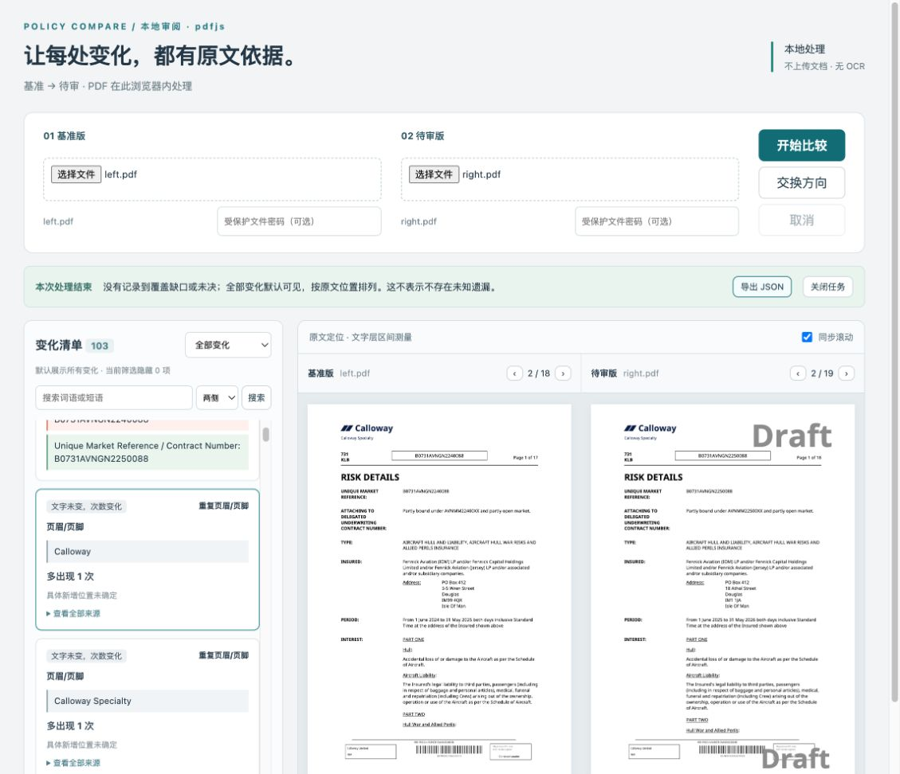

# 重复文字次数变化只突出差额

当前默认规则：纯重复次数项已移出主变化卡，统一放进独立数量摘要，默认收起详情；真实文字修改和位置变化继续保留。[当前规则与验证](../repeat-count-summary/README.md)。以下保留此前各轮展示调整的历史记录。

后续交互已调整：次数卡现在可点击定位一处明确标注为“文字示例”的来源；本文关于点击只清除高亮的描述属于前一轮行为。当前行为与验证见[次数卡文字示例定位](../count-card-source/README.md)，具体新增／减少位置仍保持未确定。

原界面把同样的 `Calloway` 放进红色旧文和绿色新文栏，还默认展开18组位置。第一版修复改成中性单栏并折叠位置，但点击卡片仍会高亮两侧相同文字。按用户进一步明确的要求，当前版本只突出数量差额，相同位置留作可选来源，不默认要求逐处审阅。

- 对文字确实相同、`hasTextChange=false`、次数不同的 Replaced 卡，原文只显示一次，主卡显示“多出现 N 次”或“少出现 N 次”，并明确“具体新增／减少位置未确定”。
- 点击次数卡或以键盘激活它，只选择卡片并清除之前的高亮，不跳页，不高亮两处相同文字。初始首卡若仅为次数差异，也不据它选择来源页或高亮。
- 完整次数、页数、上下文及全部来源收入默认关闭的“查看全部来源”；展开本身不跳页。两版来源分别列出，点击来源只定位相应一侧，并用中性色标记。来源列表不声称哪一处是真正新增，也不声称页面一一对应。
- 次数差额仍默认可见，没有按页数或页面角色忽略变化。减少次数和真实文字增删、修改继续显示。
- “按重复行对应”分别改为“重复页眉/页脚”“重复表头”或“重复文字”。
- 主动查看次数卡来源时采用中性高亮；切换到真正的文字增删，恢复原来的红绿标记。搜索及覆盖定位不会继承该次数卡的中性色状态。
- 不推断“页数增加解释了次数增加”，也不宣称整组页眉没有其他写法或业务影响。

本轮只改浏览器展示与既有测试，不改提取、比较核心、事实判断或导出格式。目前的次数卡没有能够独立证明新增／减少位置的字段，因此不把按顺序排列后剩下的最后一处当作新增，不额外开发页面身份算法。

## 验证

Node 24.22.1、pnpm 10.12.1；两引擎构建均通过。

| 检查 | PDF.js | MuPDF |
|---|---|---|
| 次数展示回归（原 R16 正反向 / R09 PDF） | 3/3 | 3/3 |
| 既有相同文档、金额、搜索、JSON导出及重复位置/覆盖跳转回归 | 3/3 | 3/3 |

共12项定向浏览器检查通过。回归复用作者预先固定的 PDF：R16 的原文相同，正向次数2→3，反向3→2；R09 的页眉金额发生2,000,000→4,000,000的真实改变。核对增减差额、具体位置未确定、来源默认不可见、鼠标／键盘选择次数卡清除高亮且不跳页、展开不跳页、单侧来源定位、导出完整次数与出现列表，以及同任务切换回真实新增／删除时恢复红绿标记。既有正向还确认完全相同的文档没有卡片，真实修改保留红绿展示，搜索和覆盖定位继续工作。

复现命令（先构建对应引擎）：

```sh
POLICY_ENGINE=pdfjs pnpm exec playwright test tests/browser/repeat-display.spec.ts --reporter=line
POLICY_ENGINE=mupdf pnpm exec playwright test tests/browser/repeat-display.spec.ts --reporter=line
POLICY_ENGINE=pdfjs pnpm exec playwright test tests/browser/review.spec.ts --grep 'P1 real PDF amount|repeated occurrences|P1 identical' --reporter=line
POLICY_ENGINE=mupdf pnpm exec playwright test tests/browser/review.spec.ts --grep 'P1 real PDF amount|repeated occurrences|P1 identical' --reporter=line
```

## 用户原文件复核

实际在 PDF.js 浏览器页面重新载入用户提供的 `left.pdf` / `right.pdf`（与商务航空固定样本一致），仍有103张卡。Calloway主卡显示“多出现1次，具体新增位置未确定”。从真实文字修改卡切到次数卡后，高亮从2处变为0处，两侧页码保持不变。展开后可分别查看17处基准来源和18处待审来源；点击“待审来源18”仅定位到待审PDF第19页，基准侧无高亮。这是来源查阅，不是把第19页认定为新增。回到次数卡后，高亮清除，全部来源收起。



[本轮实际导出核对摘要](user-file-check.json)：次数17→18、页数18→19和全部来源均保留。当前浏览器导出与已有固定产品结果递归逐字段比较，只排除 `quads`、`resolvedGeometry`、`extractionSnapshotHashes` 三类浏览器几何及快照字段，其余一致。没有把展示变化冒充比较准确率提升。

本轮没有重跑续保逐项人工验收或产品全套测试。已有的 P10/P11、页码事实及其他未评价边界保持原状态；本修复只处理用户指出的展示误导和位置列表占用。
