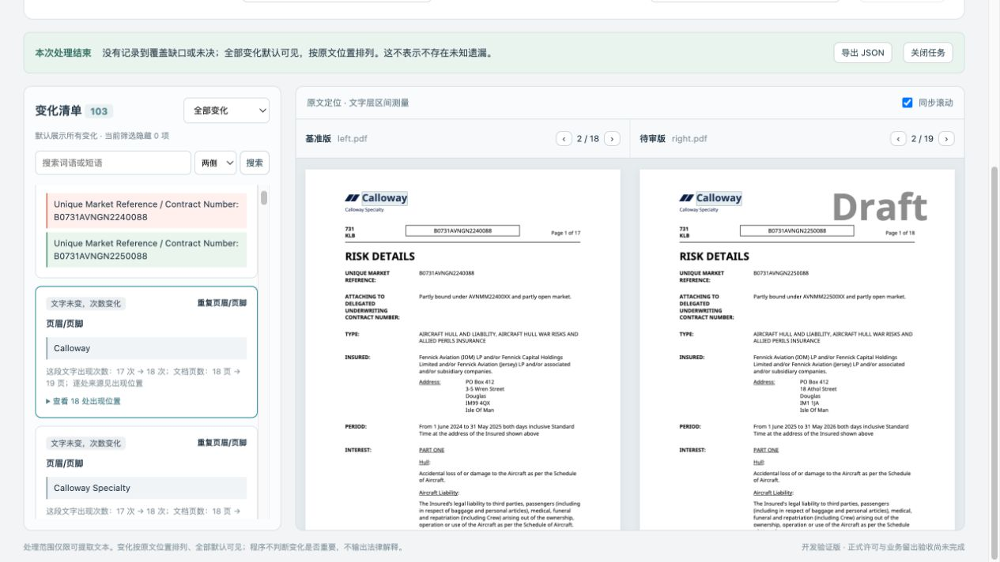

# 重复文字次数变化的展示修复

原界面把同样的 `Calloway` 放进红色旧文和绿色新文栏，还默认展开18组位置。用户很容易误以为文字被修改。本次只改浏览器展示，不改提取、比较、事实判断或导出格式。

- 对文字确实相同、`hasTextChange=false`、次数不同的 Replaced 卡，文字只显示一次，标明“文字未变，次数变化”，采用中性底色。
- 次数、页数和所有来源保留；位置列表默认收起，展开后仍可逐处跳转。次数变化本身仍默认可见，没有按页数或页面角色忽略任何变化。
- “按重复行对应”分别改为“重复页眉/页脚”“重复表头”或“重复文字”。
- 这些次数卡定位到 PDF 时也采用中性高亮；切换到真正的文字增删，恢复原来的红绿标记。搜索及覆盖定位不会继承该次数卡的中性色状态。
- 不推断“页数增加解释了次数增加”，也不宣称整组页眉没有其他写法或业务影响。

## 验证

Node 24.22.1、pnpm 10.12.1；两引擎构建均通过。

| 检查 | PDF.js | MuPDF |
|---|---|---|
| 新增次数展示回归（原 R16 / R09 PDF） | 2/2 | 2/2 |
| 既有金额、搜索、JSON导出及重复位置/覆盖跳转回归 | 2/2 | 2/2 |

新增回归复用作者预先固定的 PDF：R16 的测试声明原文相同，次数2→3；R09 的页眉金额发生2,000,000→4,000,000的真实改变。核对中性单栏、位置默认收起及展开不跳页、两侧位置跳转、中性色高亮、导出完整次数/出现列表，以及在同一次任务切换到真实新增时恢复变化高亮。正向回归确认真实修改仍显示两栏并保持红绿高亮、重复位置仍默认可访问。

复现命令（先构建对应引擎）：

```sh
POLICY_ENGINE=pdfjs pnpm exec playwright test tests/browser/repeat-display.spec.ts --reporter=line
POLICY_ENGINE=mupdf pnpm exec playwright test tests/browser/repeat-display.spec.ts --reporter=line
POLICY_ENGINE=pdfjs pnpm exec playwright test tests/browser/review.spec.ts --grep 'P1 real PDF amount|repeated occurrences' --reporter=line
POLICY_ENGINE=mupdf pnpm exec playwright test tests/browser/review.spec.ts --grep 'P1 real PDF amount|repeated occurrences' --reporter=line
```

## 用户原文件复核

实际在浏览器重新载入用户提供的 `left.pdf` / `right.pdf`（与商务航空固定样本一致），仍有103张卡。Calloway文字单栏显示、无旧/新红绿文本块，位置列表初始关闭；展开后点击第18组，待审侧可定位到PDF第19页，使用中性高亮。



[导出核对摘要](user-file-check.json)：次数17→18、页数18→19和18组出现位置均保留。当前浏览器导出与已有固定产品结果逐字段比较，除PDF.js浏览器文字层几何和提取快照哈希外一致；没有把展示变化冒充比较准确率提升。

本轮没有重跑续保逐项人工验收或产品全套测试。已有的 P10/P11、页码事实及其他未评价边界保持原状态；本修复只处理用户指出的展示误导和位置列表占用。
